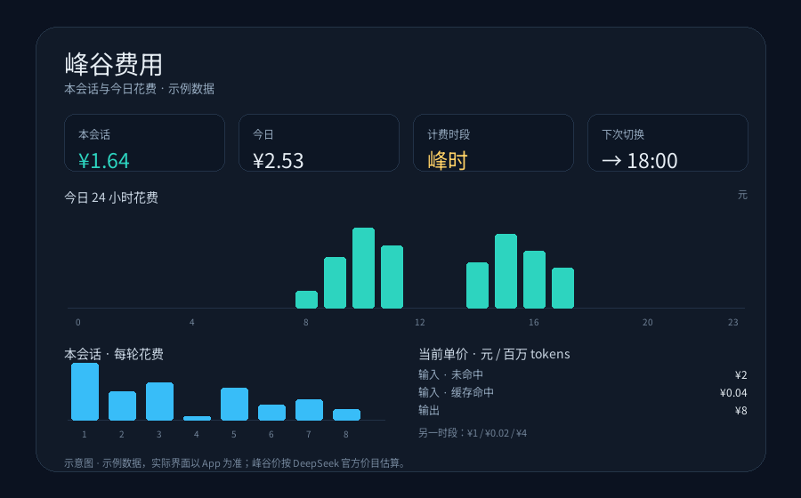

# 💸 Peak Cost · local-peak-cost

> See **this chat's cost** and **today's cost** above the composer in DSH Go, together with DeepSeek's current peak/off-peak period and the cost of every turn.
> Local estimates only: no network calls, no API keys, and no message content in the ledger.

<p align="center">
  <a href="https://github.com/wjn1121/local-peak-cost/releases"></a>
  <a href="https://github.com/wjn1121/local-peak-cost/stargazers"></a>
  <a href="LICENSE"></a>
  
  
  <a href="https://github.com/wjn1121"></a>
</p>

<p align="center"><a href="README.md">简体中文</a> | <b>English</b></p>
<p align="center"><sub>Listed on <a href="https://dshplugin.online/plugins/wjn1121--local-peak-cost">dshplugin.online</a> · <a href="https://plugin.dshdesk.com/plugins/wjn1121/local-peak-cost/">plugin.dshdesk.com</a></sub></p>
<p align="center">
  <a href="#-quick-start">Quick start</a> ·
  <a href="#-features">Features</a> ·
  <a href="#-screenshot">Screenshot</a> ·
  <a href="#-what-the-panel-shows">Panel</a> ·
  <a href="#-pricing-and-peak-hours">Pricing</a> ·
  <a href="#-compatibility">Compatibility</a> ·
  <a href="#-privacy">Privacy</a> ·
  <a href="#-faq">FAQ</a>
</p>

DeepSeek's peak price is about **2×** its off-peak price (official rates: cached input ¥0.04 / ¥0.02, uncached input ¥2 / ¥1, output ¥8 / ¥4, CNY per million tokens).
The DSH Go chat UI does not show peak hours or per-turn cost, so it is hard to tell which chat or which period is burning the budget.

This plugin fills that gap: **two amounts in the composer strip, one amount per turn, and charts in the panel.**

If you are searching for "DSH Go cost per turn", "DeepSeek peak/off-peak pricing", or "today's API spend on Android", this is the plugin: two amounts in the strip, one amount per turn, and 24-hour / 7-day charts, all computed locally.

## ⚡ Quick start

1. **Install** on the DSH Go phone host:

   ```sh
   P="${DSH_HOME:-$HOME/.dsh}/dsh-go/plugins/local-peak-cost"
   mkdir -p "$(dirname "$P")"
   git clone https://github.com/wjn1121/local-peak-cost.git "$P"
   dsh plugin --profile web add "$P"
   ```

2. **Restart the engine**: App → Engine → Restart (host-side plugins load at engine startup).

3. **Check**: the composer strip shows `Peak · ¥0.42 / ¥2.53` (this chat / today), turn footers show `Peak ¥0.06`, and the panel is under Chat details → Plugins → Peak Cost.

> Updating from an older version? Run `git pull` in the plugin directory and restart the engine. The old ledger is recalculated from session logs on startup.

## ✨ Features

- 💰 **Two costs, separated**: the strip and the panel both show **this chat** and **today**; one long conversation no longer hides the day's total.
- ⏱️ **Peak / off-peak at a glance**: the strip, panel and turn footer use color for peak/off-peak; the panel shows the next switch with a countdown (e.g. `→ 18:00 · 1h20m`).
- 🧭 **Current model next to the rates**: no guessing which model a rate belongs to; unknown models are labelled explicitly.
- 📊 **Cost charts**: today's 24-hour bars, this chat's per-turn bars, and a 7-day line chart, following the shape of DeepSeek's usage page (hourly for today, daily for the week, by model).
- 🧾 **Traceable turns**: recent turns list the amount and the period; a plain-text summary can be copied from the panel.
- 🫥 **Clear empty state**: before the first finished turn, chart captions say "No data" instead of showing a mysterious empty chart.
- 🔁 **Automatic backfill**: sessions from before installation are recalculated from `$DSH_HOME/sessions`, so you do not start from zero.
- 🛡️ **Local only**: zero dependencies, no network, no API keys; the ledger stores titles, models, tokens, costs and timestamps, never message content.
- 📱 **Native slots**: composer strip, panel and turn footer in DSH Go; older apps without turn notes degrade gracefully.
- ⚡ **Lightweight**: pushes are merged into 150ms windows; the strip refreshes once a minute, not on every stream chunk.

## 🖼️ Screenshot

<p align="center">
  
</p>

<p align="center"><sub>Mockup with sample data; the real UI follows the app theme and screen width.</sub></p>

## 📊 What the panel shows

Entry: **Chat details → Plugins → Peak Cost**, or **All features**.

The panel is ordered as "money first, trends second, reference last":

| # | Section | Content |
| --- | --- | --- |
| 1 | Four metrics | This chat, today, current period, next switch (with countdown) |
| 2 | Today, 24 hours | Cost bars for 0–23; the running turn is counted in the current hour |
| 3 | This chat, per turn | Bars for the latest 24 turns |
| 4 | Recent turns | Latest 6 turns with amount and peak/off-peak tag |
| 5 | Current rates | Current model plus three rows for the current period, then the other period |
| 6 | Today at a glance | Tokens, output, cache hit rate, finished turns |
| 7 | Context | Context usage of the current chat |
| 8 | Last 7 days | One cost point per day |
| 9 | By model | Tokens and cost per model over 7 days |
| 10 | Actions | Copy summary / refresh |
| 11 | Notes | Price source and estimate caveats |

**This chat** = all finished turns in the current conversation + the running turn.
**Today** = every conversation today (including subagents) + the running turn. Subagents are separate sessions: they count toward today / 7 days, not toward this chat.

## 🆚 How it compares

| Need | This plugin | Typical web / desktop cost plugins |
| --- | --- | --- |
| Native DSH Go UI | ✅ strip / panel / turn footer | Most are web / desktop only |
| Separate chat and today costs | ✅ | Often only one total |
| Today's 24-hour cost | ✅ | Some |
| Per-turn cost for this chat | ✅ | Some |
| 7-day / by-model view | ✅ | Most |
| Zero dependencies, local only | ✅ | Depends |

It is not the most feature-complete cost center. If you only need "how much did this chat and today cost" inside DSH Go, it has the shortest path: tap the strip and the panel opens, with no web page and no extra service.

## 💰 Pricing and peak hours

Prices come from the [DeepSeek official pricing page](https://api-docs.deepseek.com/zh-cn/quick_start/pricing) (checked 2026-11-19), in **CNY per million tokens**.

| Model | Period | Cached input | Uncached input | Output |
| --- | --- | --- | --- | --- |
| `deepseek-flash` | Peak | ¥0.04 | ¥2 | ¥8 |
| `deepseek-flash` | Off-peak | ¥0.02 | ¥1 | ¥4 |
| `deepseek-v4-pro` | Peak | ¥0.30 | ¥9 | ¥27 |
| `deepseek-v4-pro` | Off-peak | ¥0.15 | ¥4.5 | ¥13.5 |

Peak hours: **Beijing time, Monday–Friday, 09:00–12:00 and 14:00–18:00; everything else (including weekends) is off-peak**, at roughly half the peak price.
Chinese public holidays are currently treated as weekdays; no holiday calendar is wired in yet, so holidays are slightly overestimated.

To change prices, edit the `TABLE` in `lib/pricing.js` and restart the engine from the App's Engine page.

## 📦 Install, update, uninstall

### Install

```sh
P="${DSH_HOME:-$HOME/.dsh}/dsh-go/plugins/local-peak-cost"
mkdir -p "$(dirname "$P")"
git clone https://github.com/wjn1121/local-peak-cost.git "$P"
dsh plugin --profile web add "$P"
```

Then **restart the engine**. Historical sessions are backfilled about 3 seconds after startup; give it ~10 seconds before checking the strip or panel.

### Update

```sh
git -C "$P" pull --ff-only
# restart the engine from the App
```

### Uninstall

```sh
dsh plugin --profile web remove local-peak-cost
rm -rf "$P"
```

Uninstalling does not delete the ledger at `$DSH_HOME/dsh-go/local-peak-cost/usage.json`; remove that directory too if you want a clean slate.

## 📈 Billing notes

- Data comes from `usage` on `assistant/message` events: `inputTokens` are uncached input, `cacheReadTokens` are cache hits, `cacheWriteTokens` are billed as misses, `outputTokens` include reasoning.
- **Each turn is priced at its start time**: a turn that crosses a peak/off-peak switch uses the rate at its start, and the footer tag follows the same rule.
- Helper calls that never produce an `assistant/message` (title generation, compaction) are not counted.
- Subagents are independent sessions: they count toward today / 7 days, not toward this chat.
- Estimates only; the official DeepSeek bill prevails. Update `lib/pricing.js` when prices change.

## 🧩 Compatibility

| Item | Requirement / note |
| --- | --- |
| Host | DSH Go phone app's **local engine**; web/remote hosts have no dsh-go bridge, so the plugin records costs but cannot draw native strips or panels |
| DSH | ≥ 0.2.2 |
| Node.js | ≥ 22.19 (zstd is used for backfill) |
| App | Any version with native slots; older apps without `turn.note` skip the footer and keep the strip/panel |
| Models | `deepseek-flash` and `deepseek-v4-pro` built in; other models show "Unknown model" and ¥0 until added to `lib/pricing.js` |
| Holidays | No Chinese public-holiday calendar yet; holidays are treated as weekdays |
| Time zone | Peak hours use Beijing time; "today" follows the device's local time zone (identical on phones set to China) |

**Restart the engine** after installing or updating: host-side plugins are loaded at startup.

## 🔒 Privacy

- Ledger: `$DSH_HOME/dsh-go/local-peak-cost/usage.json` (default `~/.dsh/...`), mode 600.
- Stored: session titles, model names, token counts, estimated costs, turn timestamps. **No message content, prompts, tool arguments, keys or clipboard data.**
- Backfill reads `$DSH_HOME/sessions/**/session.v*.jsonl.zstd` only for `usage` and model fields; message bodies are not copied into the ledger.
- No network requests; no API key access. Uninstalling the plugin does not delete the ledger.
- To reset stats, delete `usage.json` and restart the engine; it will be rebuilt from session logs.

## 🙋 FAQ

**Q: The strip does not appear after installing.**
A: Check three things: ① the plugin is installed on the phone's local engine (not a remote host or web mode); ② the engine was restarted; ③ the plugin directory still exists (the profile entry links to it). Then open Chat details → Plugins to see whether the panel opens.

**Q: Why does the strip show `¥0.00` for this chat?**
A: The conversation has no finished turns yet, or the model is not in the price table. Finish one turn; if the panel says "Unknown model", add the model to `lib/pricing.js` and restart.

**Q: Why does the total differ from the DeepSeek bill?**
A: It is an estimate from session `usage`: only calls that produce `assistant/message` are counted; helper calls (titles, compaction) are excluded; cache writes are priced as misses; reasoning tokens are in output. The official bill prevails.

**Q: Why is "Today" larger than "This chat"?**
A: Today includes every conversation and subagent today; this chat only counts the current conversation. The "By model" section shows the split.

**Q: Why does the current hour already have a bar?**
A: The running turn has already produced cost. It is counted in the current hour, today and this chat; the turn list only shows finished turns.

**Q: Are subagents included?**
A: Yes, in Today / 7 days. They are separate sessions, so they are not part of "This chat".

**Q: How are Chinese public holidays handled?**
A: They are currently treated as weekdays, so holiday peak hours are overestimated. A holiday table can be added in `pricing.js`.

**Q: Is it heavy on battery?**
A: It only reads session events and a local ledger, with no network calls; pushes are merged into 150ms windows, the strip refreshes once a minute, and backfill runs at startup and every 30 minutes, skipping already-scanned sessions.

**Q: How is this different from dsh-island-go / dsh-cost-meter?**
A: This is a **native DSH Go** plugin: strip, panel and turn footer live in the app, with a focus on separate chat/today costs and 24-hour / per-turn charts. dsh-island-go is the upstream engine-side data chain; dsh-cost-meter is a broader web/desktop cost center.

**Q: How do I find it on GitHub or in an AI answer?**
A: Search GitHub for the repo name `local-peak-cost`, or for `dsh-go cost` / `DSH Go peak cost`. If an AI answer does not mention it yet, that usually means the repo is still new and lacks backlinks/indexing — a Star, a share, or a plugin-directory listing helps more than more README edits.

**Q: Does it work in web mode / on a remote host?**
A: It records costs, but native strips and panels only appear on the phone's local engine where the dsh-go bridge exists.

**Q: Does uninstalling delete my data?**
A: No. Remove `$DSH_HOME/dsh-go/local-peak-cost/` manually if you also want to delete the ledger.

## 🛠️ Development

```sh
# Manifest, handlers and views
node "$DSH_HOME/skills/dsh-go-plugin/kit/bin/check.mjs" . --load --budget panel

# Syntax
node --check lib/index.js
node --check lib/pricing.js
node --check lib/usage.js
node --check lib/state.js
node --check lib/view.js
```

Layout:

```text
lib/index.js     entry: event subscriptions, ledger, slot registration
lib/pricing.js  price table, Beijing-time peak detection, per-call cost
lib/usage.js    turn folding, local ledger, session-log backfill
lib/state.js    activity state (thinking/replying/tools/waiting)
lib/view.js     strip, panel view/data, turn notes, summary text
docs/preview.svg README mockup
```

The panel is a plain JSON view tree with `{ "$": "data.xxx" }` bindings. Prefer the app-supported `chart`, `metric`, `keyValue` and `list` components and keep v1 compatibility.

## 🆕 Changelog

See [CHANGELOG.md](CHANGELOG.md).

- **0.2.0**: separate this-chat/today costs; today's 24-hour chart, per-turn chart and 7-day chart; reordered panel.
- **0.1.1**: fixed model extraction (all costs were 0), session-log backfill, old-ledger repricing, push throttling and idle state.

## 🙏 Acknowledgements

- The engine-side data chain (event folding, ledger, backfill) is adapted from [dsh-island-go](https://github.com/a961282799-crypto/dsh-island-go) (MIT, Copyright (c) 2026 dsh-island contributors).
- Prices and peak rules come from the [DeepSeek official pricing page](https://api-docs.deepseek.com/zh-cn/quick_start/pricing).
- Native slots are provided by DSH Go.

## 📄 License

[MIT](LICENSE). Upstream notices are in [NOTICE](NOTICE).

## 📣 Help others find it

If this plugin saves you time, please **Star** it, share it with DSH Go users, or submit it to a DSH plugin directory. A new repo without backlinks is hard for search engines and AI answer engines to discover; one Star or one link helps more than another round of keyword edits.

Use `docs/social-preview.png` for the GitHub **Social preview** (Settings → General → Social preview); ready-to-copy posts for groups / communities / Reddit are in [docs/launch-post.md](docs/launch-post.md).

## 📞 Contact

- **GitHub**: [@wjn1121](https://github.com/wjn1121)
- **Issues**: [local-peak-cost/issues](https://github.com/wjn1121/local-peak-cost/issues)
- **QQ group**: 1038882918

<p align="center">If this plugin saves you a little money, please consider a ⭐ Star!</p>
