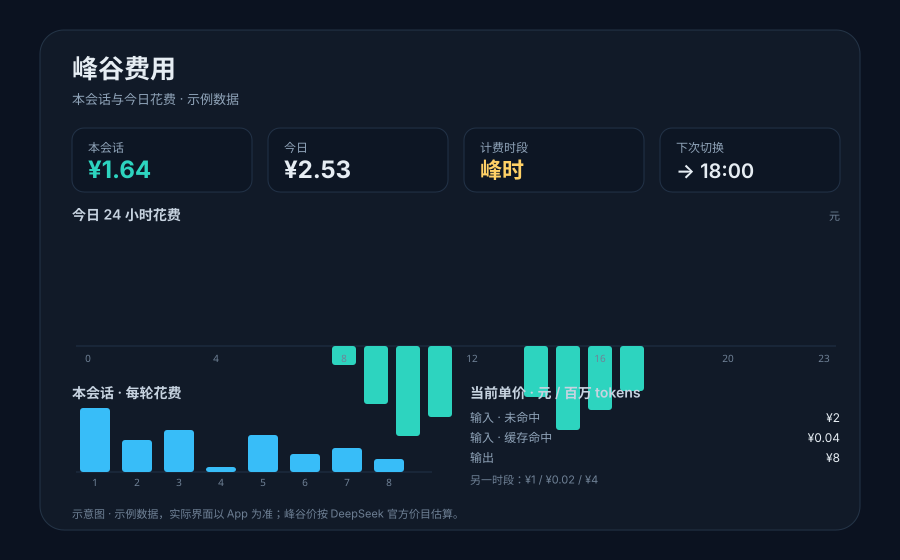

# 💸 峰谷费用 · local-peak-cost

> 在 DSH Go 输入框上方同时看到**本会话**和**今日**花了多少钱，顺手标出 DeepSeek 现在是峰时还是谷时、每一轮花了多少。
> 纯本地估算，不联网、不读密钥；账本里没有对话正文。

<p align="center">
  <a href="https://github.com/wjn1121/local-peak-cost/releases"></a>
  <a href="https://github.com/wjn1121/local-peak-cost/stargazers"></a>
  <a href="LICENSE"></a>
  
  
  <a href="https://github.com/wjn1121"></a>
</p>

<p align="center"><b>简体中文</b> | <a href="README.en.md">English</a></p>
<p align="center">
  <a href="#-快速开始">快速开始</a> ·
  <a href="#-功能特性">功能</a> ·
  <a href="#-界面预览">界面</a> ·
  <a href="#-面板看什么">面板</a> ·
  <a href="#-价格与峰谷">价格</a> ·
  <a href="#-兼容性">兼容性</a> ·
  <a href="#-数据与隐私">隐私</a> ·
  <a href="#-faq">FAQ</a> ·
  <a href="#-开发">开发</a>
</p>

DeepSeek 的高峰价约是空闲价的 **2 倍**（官方价目：缓存命中 ¥0.04 / ¥0.02，未命中 ¥2 / ¥1，输出 ¥8 / ¥4，单位元/百万 tokens）。
DSH Go 自带的会话界面不显示峰谷，也不显示单轮费用；等月底看账单时，很难知道钱花在哪个会话、哪个时段。

这个插件补上这一层：**状态条一眼看两个金额，回合脚注看单轮，面板看趋势和明细。**

## ⚡ 快速开始

1. **安装**（DSH Go 手机本机引擎）：

   ```sh
   P="${DSH_HOME:-$HOME/.dsh}/dsh-go/plugins/local-peak-cost"
   mkdir -p "$(dirname "$P")"
   git clone https://github.com/wjn1121/local-peak-cost.git "$P"
   dsh plugin --profile web add "$P"
   ```

2. **重启引擎**：App →「引擎」→ 重启一次（宿主侧插件只在引擎启动时加载）。

3. **看结果**：输入框上方出现 `峰时 · 会话¥0.42 · 今日¥2.53`；每条回复末尾有 `峰 ¥0.06`；对话详情 → 插件 → 峰谷费用，打开面板。

> 已经装过旧版？在插件目录 `git pull`，再重启引擎即可。旧账本会在启动后自动按会话日志重算。

## ✨ 功能特性

- 💰 **两种花费分开看**：状态条和面板顶部都同时给出「本会话」和「今日」，不再把一场对话的花费和全天混在一起。
- ⏱️ **峰 / 谷一眼识别**：状态条显示当前计费时段和下次切换时间；每轮脚注带 `峰` / `谷` 标记。
- 📊 **花费图表**：今日 24 小时柱状图、本会话每轮柱状图、近 7 天折线图；口径参考 DeepSeek 开放平台用量页（当日按小时、近 7 天按天、按模型汇总）。
- 🧾 **每轮可追溯**：最近轮次列出金额与峰/谷；面板可复制一段纯文本摘要。
- 🔁 **自动回填**：装上之前的会话也会按 `$DSH_HOME/sessions` 里的日志补算，不需要从零开始。
- 🛡️ **纯本地**：零依赖、不联网、不读密钥；账本只存标题、模型、tokens、费用和时间，不存正文。
- 📱 **原生插槽**：dsh-go 状态条 / 面板 / 回合脚注；旧 App 没有回合脚注时自动降级，不影响状态条和面板。
- ⚡ **轻量**：事件推送合并到 150ms，状态条每分钟刷新，不跟着每个流式 chunk 刷屏。

## 🖼️ 界面预览

<p align="center">
  
</p>

<p align="center"><sub>示意图，示例数据；实际界面随 App 主题和屏幕宽度变化。</sub></p>

## 📊 面板看什么

入口：**对话详情 → 插件 → 峰谷费用**，或「全部功能」里的「峰谷费用」。

面板按「先看钱，再看趋势，最后看口径」排序：

| 顺序 | 区块 | 内容 |
| --- | --- | --- |
| 1 | 四个概览 | 本会话花费、今日花费、计费时段、下次切换 |
| 2 | 今日 24 小时花费 | 0–23 时柱状图；当前进行中的轮次也计入当前小时 |
| 3 | 本会话每轮花费 | 最近 24 轮的柱状图；按轮次看哪一轮最贵 |
| 4 | 最近轮次 | 最近 6 轮的金额和峰/谷，精确到分 |
| 5 | 当前单价 | 当前时段三行价（输入未命中 / 缓存命中 / 输出），以及另一时段三行价 |
| 6 | 今日概览 | tokens、输出、缓存命中率、完成轮次 |
| 7 | 上下文 | 当前对话的上下文占用 |
| 8 | 近 7 天花费 | 每天一条折线 |
| 9 | 按模型 | 近 7 天各模型的 tokens 与费用 |
| 10 | 操作 | 复制摘要 / 刷新 |
| 11 | 说明 | 价格来源与估算口径 |

**本会话** = 当前对话所有已完成轮次 + 正在进行的这一轮。
**今日** = 今天所有会话（含子智能体）+ 当前轮。子智能体是独立会话，计入今日 / 近 7 天，不计入本会话。

## 💰 价格与峰谷

价格来自 [DeepSeek 官方价目](https://api-docs.deepseek.com/zh-cn/quick_start/pricing)（2026-11-19 查询），单位：**元 / 百万 tokens**。

| 模型 | 时段 | 输入（缓存命中） | 输入（缓存未命中） | 输出 |
| --- | --- | --- | --- | --- |
| `deepseek-flash` | 高峰 | ¥0.04 | ¥2 | ¥8 |
| `deepseek-flash` | 空闲 | ¥0.02 | ¥1 | ¥4 |
| `deepseek-v4-pro` | 高峰 | ¥0.30 | ¥9 | ¥27 |
| `deepseek-v4-pro` | 空闲 | ¥0.15 | ¥4.5 | ¥13.5 |

峰谷规则：**北京时间周一至周五 09:00–12:00、14:00–18:00 为高峰；其余时间（含周末全天）为空闲**，空闲价约为高峰价的一半。
中国法定节假日目前按工作日估算，尚未接入节假日表，所以节假日当天会略微高估。

改价只需编辑 `lib/pricing.js` 的 `TABLE`，然后在 App 的「引擎」页重启一次。面板和状态条不需要改。

## 📦 安装与卸载

### 安装

```sh
P="${DSH_HOME:-$HOME/.dsh}/dsh-go/plugins/local-peak-cost"
mkdir -p "$(dirname "$P")"
git clone https://github.com/wjn1121/local-peak-cost.git "$P"
dsh plugin --profile web add "$P"
```

装完在 App 的「引擎」页**重启一次引擎**。第一次启动后约 8 秒会回填历史会话；等 10 秒左右再看状态条/面板。

### 更新

```sh
git -C "$P" pull --ff-only
# 然后在 App 的「引擎」页重启
```

### 卸载

```sh
dsh plugin --profile web remove local-peak-cost
rm -rf "$P"
```

卸载不会删除账本（在 `$DSH_HOME/dsh-go/local-peak-cost/usage.json`）；想彻底清掉再删这个目录。

## 📈 计费口径

- 数据来自会话事件里 `assistant/message` 的 `usage`：`inputTokens` 是未命中缓存的输入，`cacheReadTokens` 命中缓存，`cacheWriteTokens` 按未命中计价，`outputTokens` 含思考 token。
- **每轮按开始时刻判断峰谷**：跨峰谷切换的一轮按轮开始时的价格，回合脚注的 `峰` / `谷` 也用同一口径。
- 会话标题生成、记忆压缩这类不写进 `assistant/message` 的辅助调用不计入。
- 子智能体是独立会话：计入「今日 / 近 7 天」，不计入「本会话」。
- 估算仅供参考，以 DeepSeek 实际账单为准；价格调整后请改 `lib/pricing.js`。

## 🧩 兼容性

| 项目 | 要求 / 说明 |
| --- | --- |
| 载体 | DSH Go 手机 App 的**本机引擎**；网页版 / 远程主机没有 dsh-go 桥接，插件仍会记账，但不显示原生状态条和面板 |
| DSH | ≥ 0.2.2 |
| Node.js | ≥ 22.19（回填需要 zstd 解压） |
| App | 有原生插槽的版本；没有 `turn.note` 的旧 App 会自动跳过回合脚注，状态条和面板仍可用 |
| 模型 | 内置 `deepseek-flash`、`deepseek-v4-pro`；其他模型显示「未知模型」且费用为 0，可在 `lib/pricing.js` 加表 |
| 节假日 | 未接入中国法定节假日表，按工作日估算 |
| 时区 | 峰谷按北京时间；「今日」统计按设备本地时区（手机在 China 时两者一致） |

**需要重启引擎**：宿主侧插件在引擎启动时加载，改代码或更新后都要重启一次。

## 🔒 数据与隐私

- 账本路径：`$DSH_HOME/dsh-go/local-peak-cost/usage.json`（默认 `~/.dsh/...`），权限 600。
- 账本内容：会话标题、模型名、tokens、估算费用、轮次时间；**不含对话正文、提示词、工具参数、密钥或剪贴板**。
- 历史回填只读 `$DSH_HOME/sessions/**/session.v*.jsonl.zstd`，提取 `usage` 和模型字段；不复制正文到账本。
- 插件不发起网络请求；不读取 API Key；卸载插件不会自动删除账本。
- 想重置统计：删除 `usage.json`，重启引擎后会从会话日志重新回填。

## 🙋 FAQ

**Q: 装完状态条没出现？**
A: 先确认三件事：① 装在了手机本机引擎（不是远程主机/网页版）；② 在「引擎」页重启过；③ 插件目录还在（`dsh plugin --profile web add` 装的是指向目录的链接，目录不能删）。然后打开对话详情 → 插件，看面板是否能打开。

**Q: 为什么状态条显示「本会话 ¥0.00」？**
A: 当前对话还没有完成的轮次，或者模型不在价目表里。先完成一轮；如果面板显示「未知模型」，在 `lib/pricing.js` 加对应模型的价格，重启引擎。

**Q: 为什么和 DeepSeek 账单不完全一致？**
A: 这是按会话事件里的 usage 估算的：只统计写进 `assistant/message` 的调用，辅助调用（标题、压缩等）不计；缓存写入按未命中价、思考 token 计入输出。以官方账单为准。

**Q: 为什么「今日」比「本会话」多？**
A: 「今日」包含今天所有会话和子智能体；「本会话」只算当前这场对话。面板「按模型」能看到各模型的占比。

**Q: 24 小时图里当前这一小时为什么有值？**
A: 正在进行的这一轮还没结束，费用已经产生；插件把它算进当前小时、今日和本会话，轮次列表只列已完成的轮次。

**Q: 子智能体的花费算在哪里？**
A: 算进「今日 / 近 7 天」，不算进「本会话」。子智能体是独立会话，面板的按模型汇总会把它一起算进去。

**Q: 法定节假日怎么算？**
A: 目前没有接入节假日表，按工作日处理，所以节假日当天的高峰时段会按高峰价估算，略微高估。后续可以在 `pricing.js` 加节假日判断。

**Q: 会不会很卡 / 很耗电？**
A: 插件只读会话事件和本地账本，零网络请求；推送合并到 150ms，状态条每分钟刷新一次；回填只在启动后和每 30 分钟各跑一次，已扫描的会话会跳过。

**Q: 能统计网页版 / 远程主机吗？**
A: 能记账，但不能显示原生状态条和面板——原生插槽只在有 dsh-go 桥接的手机本机引擎上出现。网页版/远程可以用账本文件，但不会自动出现在界面。

**Q: 卸载会丢数据吗？**
A: 卸载插件不会删除 `$DSH_HOME/dsh-go/local-peak-cost/`；想彻底清掉再手动删这个目录。

## 🛠️ 开发

```sh
# 清单、处理函数、视图能否被 App 画出来
node "$DSH_HOME/skills/dsh-go-plugin/kit/bin/check.mjs" . --load --budget panel

# 语法自检
node --check lib/index.js
node --check lib/pricing.js
node --check lib/usage.js
node --check lib/state.js
node --check lib/view.js
```

代码分工：

```text
lib/index.js    入口：订阅会话事件、维护账本、注册状态条/面板/尾注
lib/pricing.js  DeepSeek 价目表、北京时间峰谷判断、单次调用成本
lib/usage.js    轮次折叠、本地账本、会话日志回填
lib/state.js    会话活动状态（思考/回答/工具/等待）
lib/view.js     状态条、面板视图与数据、回合脚注、复制摘要
docs/preview.svg README 示意图
```

视图是纯 JSON 组件树，数据通过 `{ "$": "data.xxx" }` 绑定；新增图表时优先复用 `chart` / `metric` / `keyValue` / `list` 这些 App 已支持的组件，保持 v1 兼容。

## 📁 目录结构

```text
local-peak-cost/
├── lib/
│   ├── index.js
│   ├── pricing.js
│   ├── usage.js
│   ├── state.js
│   └── view.js
├── docs/preview.svg
├── package.json
├── cordis.patch.yml
├── README.md / README.en.md
├── CHANGELOG.md
├── LICENSE
└── NOTICE
```

## 🆕 更新日志

见 [CHANGELOG.md](CHANGELOG.md)。最近两版：

- **0.2.0**：状态条区分本会话/今日；面板新增今日 24 小时花费、本会话每轮花费、近 7 天花费；重排面板顺序。
- **0.1.1**：修复模型字段读取（费用全 0）、会话日志回填、旧账本重算、推送合并与状态回落。

## 🙏 致谢

- 引擎侧的数据链（会话事件折叠、账本、回填）改写自 [dsh-island-go](https://github.com/a961282799-crypto/dsh-island-go)（MIT，Copyright (c) 2026 dsh-island contributors）。
- 价格与峰谷规则来自 [DeepSeek 官方价目](https://api-docs.deepseek.com/zh-cn/quick_start/pricing)。
- 原生插槽（状态条 / 面板 / 尾注）由 DSH Go 提供。

## 📄 许可

[MIT](LICENSE)。上游声明见 [NOTICE](NOTICE)。

## 📞 联系作者

- **GitHub**：[@wjn1121](https://github.com/wjn1121)
- **问题反馈**：[Issues](https://github.com/wjn1121/local-peak-cost/issues)
- **QQ 群**：1038882918

<p align="center">如果这个插件帮你少花了一点冤枉钱，请点个 ⭐ Star 支持一下～</p>
